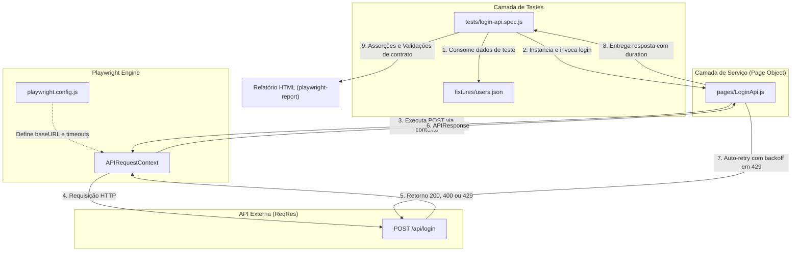
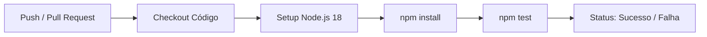

# 🔐 Projeto Playwright - Validação de Login (Backend Only)


Projeto de automação de testes de backend focado na validação de integridade, contratos e comportamento do endpoint de autenticação `/api/login` da API **ReqRes**, utilizando **Playwright** com `APIRequestContext`, padrão de projeto **Service Object (Page Object para API)** e massas desacopladas via **Fixtures JSON**.

> [!NOTE]
> **Foco exclusivo no Backend:** Não há interface gráfica, emulação de navegador ou seletores de tela envolvidos. Todas as interações ocorrem via protocolo HTTP com alto desempenho e baixo consumo de recursos.

---

## 📑 Sumário

- [🎯 Objetivos e Cobertura](#-objetivos-e-cobertura)
- [🏗️ Arquitetura e Fluxo de Execução](#️-arquitetura-e-fluxo-de-execução)
- [📁 Estrutura do Repositório](#-estrutura-do-repositório)
- [🛠️ Tecnologias e Padrões](#️-tecnologias-e-padrões)
- [🛡️ Resiliência e Estratégia Anti-Flakiness](#️-resiliência-e-estratégia-anti-flakiness)
- [⚠️ Disclaimer sobre Rate Limiting e Identificação de Bot](#-disclaimer-sobre-rate-limiting-e-identificação-de-bot)
- [🧪 Cenários de Teste](#-cenários-de-teste)
- [📦 Massas de Dados (Fixtures)](#-massas-de-dados-fixtures)
- [🌐 Contrato da API (ReqRes)](#-contrato-da-api-reqres)
- [🚀 Instalação e Execução](#-instalação-e-execução)
- [🔁 Pipeline de CI/CD](#-pipeline-de-cicd)
- [📊 Relatórios e Diagnóstico](#-relatórios-e-diagnóstico)
- [🤝 Contribuição](#-contribuição)
- [📄 Licença e Autor](#-licença-e-autor)

---

## 🎯 Objetivos e Cobertura

Validar o endpoint de autenticação de ponta a ponta com foco em:

- **Códigos de Resposta HTTP:** Garantia de status `200 OK` para logins válidos e `400 Bad Request` para entradas inválidas.
- **Validação de Token:** Existência, tipo (`string`) e comprimento não vazio do token de autenticação retornado.
- **Mensagens de Erro e Negócio:** Validação das mensagens de erro retornadas (`Missing password`, `Missing email or username`, `user not found`).
- **Validação de Campos Obrigatórios:** Respostas adequadas para ausência de `email`, ausência de `password` e payload completamente vazio `{}`.
- **Contrato de Headers e Metadados:** Validação do cabeçalho `Content-Type: application/json` e SLA de tempo de resposta (`duration`).
- **Fluxo Completo de Sucesso e Falha:** Validação encadeada de contratos positivos e negativos.

---

## 🏗️ Arquitetura e Fluxo de Execução

O projeto segue a separação de responsabilidades em camadas:



---

## 📁 Estrutura do Repositório

```
playwright-login-api/
├── .github/
│   └── workflows/
│       └── playwright.yml     # Workflow de CI/CD para execução automática no GitHub Actions
├── fixtures/
│   └── users.json             # Massas de dados organizadas por cenário (válido, inválido, vazio)
├── pages/
│   └── LoginApi.js            # Service Object que encapsula chamadas HTTP, retries e asserções
├── tests/
│   └── login-api.spec.js      # Especificações dos testes com describe e asserções do Playwright
├── .gitignore                 # Arquivos ignorados pelo Git (node_modules, reports, logs)
├── LICENSE                    # Licença MIT
├── package.json               # Dependências, scripts npm e metadados do projeto
├── playwright.config.js       # Configurações globais do Playwright (baseURL, timeout, retries)
└── README.md                  # Documentação completa do projeto
```

### Responsabilidades dos Arquivos

| Arquivo | Camada | Responsabilidade |
| :--- | :--- | :--- |
| `playwright.config.js` | Configuração | Define `baseURL`, timeouts globais de 30s, reporter HTML e retries do runner |
| `package.json` | Gestão | Gerencia scripts de execução (`npm test`, `npm run test:ui`) e dependências |
| `fixtures/users.json` | Dados | Centraliza dados de entrada (happy path, credenciais incorretas e campos faltantes) |
| `pages/LoginApi.js` | Service/PO | Encapsula o endpoint `/api/login`, captura de métrica de tempo (`duration`), tratamento defensivo de rate limit (429) e validações reutilizáveis |
| `tests/login-api.spec.js` | Testes | Implementa as suites de asserções organizadas por objetivos de teste |
| `.github/workflows/playwright.yml` | DevOps | Executa a suite de testes a cada push ou pull request na branch principal |

---

## 🛠️ Tecnologias e Padrões

- **[Playwright](https://playwright.dev/) (`@playwright/test`)** — Test runner robusto e moderno com suporte nativo a requisições de API via `APIRequestContext`.
- **Page Object Model (adaptado para API / Service Object)** — Abstrai a lógica de montagem da requisição e retries da camada de especificação de testes.
- **Fixtures Baseadas em JSON** — Separação clara entre lógica de teste e massas de entrada, permitindo fácil manutenção e testes parametrizados.
- **Expect Integrado** — Biblioteca de asserções síncronas e assíncronas do Playwright para contratos e propriedades JSON.

---

## 🛡️ Resiliência e Estratégia Anti-Flakiness

A API pública `reqres.in` implementa limites de taxa de requisições e frequentemente responde com o código HTTP `429 Too Many Requests`. Para assegurar testes confiáveis e livres de falso-negativo (flaky tests), o projeto utiliza **backoff exponencial + cabeçalho `Retry-After` + jitter**:

1. **Retry com backoff exponencial (`pages/LoginApi.js`):**
   - Intercepta respostas com status `429` imediatamente após a chamada.
   - Aplica espera com backoff exponencial (`baseDelay × 2^(attempt-1)`), respeitando o cabeçalho `Retry-After` quando presente.
   - Adiciona jitter aleatório (±30%) para evitar rajadas sincronizadas.
   - Limite padrão: `maxRetries = 5`, `retryDelay = 2000 ms`.
   - Após esgotar as tentativas, lança um erro descritivo em vez de devolver um 429 opaco.

2. **Execução serial no CI (`playwright.config.js`):**
   - `workers: 1` — evita paralelismo que multiplica o consumo de quota.
   - `retries: 1` — reduz consumo de quota da API keyless.
   - Suporte a `x-api-key` via variável de ambiente `REQRES_API_KEY`.

3. **Delay entre testes (`tests/login-api.spec.js`):**
   - `afterEach` fecha o navegador (quando usado) e aguarda 800 ms antes do próximo teste.

> [!TIP]
> Para evitar o limite de 40 requisições/dia do endpoint keyless, crie uma chave gratuita em https://app.reqres.in e defina a variável de ambiente `REQRES_API_KEY`.

---

## ⚠️ Disclaimer sobre Rate Limiting e Identificação de Bot

O **Playwright** (Node.js) utiliza o `APIRequestContext` para requisições de backend. Esse mecanismo dispara requisições HTTP **diretas via stack de rede do Node.js**, sem passar por um navegador real. Como resultado:

- O `User-Agent`, cabeçalhos TLS e comportamento de rede são distintos de um navegador legítimo.
- A API ReqRes identifica esse tráfego como **requisição de script/bot**, não como navegação humana.
- Essa identificação contribui para o bloqueio por **rate limit (HTTP 429)** no endpoint keyless (limite de 40 requisições/dia por IP).

### Comparação com outras frameworks

| Framework | Como executa requisições | Identificação pela API ReqRes |
|-----------|--------------------------|-------------------------------|
| **Playwright (Node.js)** | `APIRequestContext` (HTTP direto via Node) | Identificado como bot/script → mais sujeito a 429 |
| **Python (requests/playwright)** | Pode usar `fetch` nativo de navegador real via `page.evaluate` ou navegador real completo | Menos sujeito a detecção de bot quando usa navegador real |
| **Cypress** | Executa dentro de navegador real (Chromium/Electron/Firefox) | Tráfego originado de navegador real → menos sujeito a 429 |

> [!NOTE]
> Este projeto inclui suporte opcional a **fetch via navegador real** (`useBrowserFetch: true`) no `LoginApi.js`, que utiliza o `fetch()` nativo do Chromium via `page.evaluate`. Isso aproxima o comportamento de frameworks que rodam no navegador, mas **não elimina o rate limit por IP** — apenas reduz a detecção como bot.

Para eliminar definitivamente o 429, a recomendação continua sendo obter uma **API Key gratuita** em https://app.reqres.in e configurar a variável `REQRES_API_KEY`.

---

2. **Retry no Test Runner (`playwright.config.js`):**
   - Configurado com `retries: 2` para falhas de conectividade ou oscilações de rede mais severas.
   - Timeout individual calibrado em 30 segundos (`timeout: 30000`).

---

## 🧪 Cenários de Teste

| # | Cenário | Objetivo | Asserções Principais |
| :-: | :--- | :--- | :--- |
| **1** | **Validação de Estrutura** | Assegurar integridade geral da resposta | Status 200, body possui `token` não vazio, `content-type` JSON e `duration < 30000ms` |
| **2** | **Login Válido** | Validar happy path com credenciais corretas | Status 200 e recebimento do token em formato string |
| **3** | **Login Inválido** | Validar rejeição de usuário não cadastrado | Status 400 e propriedade `error` informando `user not found` |
| **4** | **Campos Obrigatórios** | Testar ausência de atributos essenciais | Status 400 para: sem password, sem email e body vazio `{}` |
| **5** | **Fluxo Completo** | Teste integrado de ponta a ponta | Execução sequencial de caso positivo e todos os casos negativos |

---

## 📦 Massas de Dados (Fixtures)

As massas ficam centralizadas no arquivo [`fixtures/users.json`](file:///c:/Users/familia-sampaio/Documents/playwright-login-api/playwright-login-api/fixtures/users.json):

```json
{
  "validUser": {
    "email": "eve.holt@reqres.in",
    "password": "cityslicka"
  },
  "invalidUser": {
    "email": "usuario_invalido@email.com",
    "password": "senha_errada"
  },
  "missingPassword": {
    "email": "eve.holt@reqres.in"
  },
  "missingEmail": {
    "password": "cityslicka"
  },
  "emptyBody": {}
}
```

> [!IMPORTANT]
> **Particularidade da API ReqRes:** A API ReqRes não realiza checagem de hash da senha; ela verifica se o e-mail informado existe em seu banco mockado. Portanto, para testar credenciais inválidas com status 400 (`user not found`), o campo `email` deve ser um endereço não registrado (ex: `usuario_invalido@email.com`).

---

## 🌐 Contrato da API (ReqRes)

- **Base URL:** `https://reqres.in`
- **Endpoint:** `POST /api/login`
- **Headers Padrão:** `Content-Type: application/json`

### Resumo dos Contratos

```
POST /api/login HTTP/1.1
Host: reqres.in
Content-Type: application/json
```

| Condição de Entrada | Status Esperado | Payload de Resposta |
| :--- | :---: | :--- |
| Credenciais corretas | `200 OK` | `{"token": "QpwL5tke4Pnpja7X4"}` |
| Usuário não cadastrado | `400 Bad Request` | `{"error": "user not found"}` |
| Sem campo `password` | `400 Bad Request` | `{"error": "Missing password"}` |
| Sem campo `email` | `400 Bad Request` | `{"error": "Missing email or username"}` |
| Payload vazio `{}` | `400 Bad Request` | `{"error": "Missing email or username"}` |

---

## 🚀 Instalação e Execução

### Pré-requisitos

- **Node.js** 18.x ou superior
- **npm** 9.x ou superior

### Passo a Passo de Instalação

```bash
# 1. Clonar o repositório
git clone https://github.com/guilhermegiovane94/playwright-login-api.git
cd playwright-login-api

# 2. Instalar as dependências do projeto
npm install

# 3. (Opcional mas recomendado) Definir a chave da ReqRes para evitar 429
# Crie uma chave gratuita em https://app.reqres.in
export REQRES_API_KEY=sua_chave_aqui
```

### Comandos de Teste Disponíveis

| Comando | Finalidade |
| :--- | :--- |
| `npm test` | Executa todos os testes no terminal em modo headless (ideal para CI/CD) |
| `npm run test:ui` | Abre a interface gráfica interativa do Playwright (UI Mode) |
| `npm run test:debug` | Executa os testes em modo interativo de depuração passo a passo |

### Exemplos Práticos

```bash
# Executar a suite completa
npm test

# Executar apenas testes que contenham "credenciais válidas" no título
npx playwright test -g "credenciais válidas"

# Executar e gerar o relatório HTML
npx playwright test --reporter=html

# Abrir o relatório HTML gerado no navegador
npx playwright show-report
```

---

## 🔁 Pipeline de CI/CD

O projeto possui integração contínua configurada via **GitHub Actions** em [`.github/workflows/playwright.yml`](file:///c:/Users/familia-sampaio/Documents/playwright-login-api/playwright-login-api/.github/workflows/playwright.yml).

A cada `push` ou `pull_request` direcionado à branch `main`, a pipeline é disparada em um ambiente `ubuntu-latest`:



---

## 📊 Relatórios e Diagnóstico

Após a execução dos testes, o Playwright gera artefatos detalhados:

- **`playwright-report/`** — Relatório HTML visual contendo o tempo de execução de cada teste, status, payloads enviados e respostas recebidas.
- **`test-results/`** — Dados brutos de cada spec executada, úteis para depuração aprofundada em ambientes de integração contínua.

Para inspecionar o relatório mais recente, basta executar:
```bash
npx playwright show-report
```

---

## 🤝 Contribuição

1. Faça um **Fork** deste repositório.
2. Crie uma branch para sua funcionalidade ou correção:
   ```bash
   git checkout -b feature/novo-cenario
   ```
3. Realize seus commits seguindo o padrão [Conventional Commits](https://www.conventionalcommits.org/):
   ```bash
   git commit -m "feat: adiciona teste de contrato com schema validation"
   ```
4. Envie as alterações para o seu repositório remoto:
   ```bash
   git push origin feature/novo-cenario
   ```
5. Abra um **Pull Request** detalhando as alterações.

---

## 📄 Licença e Autor

Este projeto está licenciado sob a **Licença MIT** — consulte o arquivo [LICENSE](LICENSE) para mais detalhes.

Desenvolvido por **Guilherme Giovane**  
*Automação de Testes de API Backend com Playwright*
